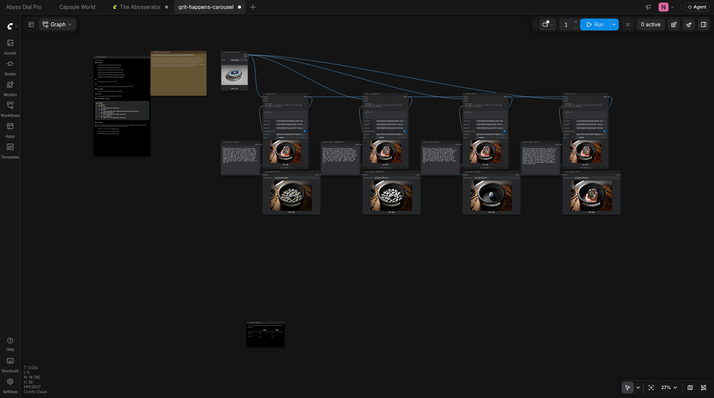

# Grit Happens

> "Can I tumble this?" Yes. Anything. Four grit stages later it comes out as a polished stone with the thing you put in as its agate banding.

An entry for Comfy's [Open Source Higgsfield](https://comfy.org/open-source-higgsfield) competition. Apache-2.0 weights only, core ComfyUI nodes only, Apache-2.0 repo.

## What it does

Rockhound internet has two genres: the "can I tumble this?" post (answer: "what's its Mohs hardness?") and the
four-weeks-later stage-4 reveal. Grit Happens does both with any object photo, as a swipeable four-slide carousel.

1. **Carousel** (`workflows/grit-happens-carousel.json`): one run, four chained Qwen-Image-Edit-2511 stages:
   - Stage 1 ROUGH: the object, walnut-sized and turned to rough stone, in an open tumbler barrel.
   - Stage 2 COARSE 60/90: rounded, slurry-covered, faint bands from the object.
   - Stage 3 FINE 500: smooth satin pebble, concentric bands in the object's colours and motifs.
   - Stage 4 POLISH: glossy stone on a palm; the banding *is* the object.

   Stages 2–4 take the previous stage as image 1 and the **original object as image 2**, so the colours don't drift.
   Stage names go in the post caption, not in the image (the model garbles text).
2. **Reveal, optional** (`workflows/grit-happens-reveal.json`): Wan 2.2 I2V A14B first-last-frame from the stage-1
   still to the stage-4 still: slurry rinsed away, a hand lifts the stone.

Exact prompts: `prompts/prompts.json` (also stored in the workflow).

**Run status (2026-11-02 ET):** the carousel has been run on Comfy Cloud. After the first run the prompts were revised: the taped stage labels came out garbled ("STAGE 2 · COUGH") and the look
was too clean, so all in-image text was dropped and the look pushed toward an unglamorous phone snapshot.
`grit-happens-reveal.json` has **not been run yet**.

## Requirements

- ComfyUI 0.16.4 or newer (desktop, portable or self-hosted), or Comfy Cloud, where the examples were made.
- Core nodes only. No custom nodes, no partner nodes, no paid APIs.
- These model files (all Apache-2.0):

| File | Put in `ComfyUI/models/…` | Download | License |
|---|---|---|---|
| `qwen_image_edit_2511_fp8mixed.safetensors` | `diffusion_models/` | [link](https://huggingface.co/Comfy-Org/Qwen-Image-Edit_ComfyUI/resolve/main/split_files/diffusion_models/qwen_image_edit_2511_fp8mixed.safetensors) | Apache-2.0 (upstream https://huggingface.co/Qwen/Qwen-Image-Edit-2511) |
| `qwen_2.5_vl_7b_fp8_scaled.safetensors` | `text_encoders/` | [link](https://huggingface.co/Comfy-Org/HunyuanVideo_1.5_repackaged/resolve/main/split_files/text_encoders/qwen_2.5_vl_7b_fp8_scaled.safetensors) | Apache-2.0 (upstream https://huggingface.co/Qwen/Qwen2.5-VL-7B-Instruct) |
| `qwen_image_vae.safetensors` | `vae/` | [link](https://huggingface.co/Comfy-Org/Qwen-Image_ComfyUI/resolve/main/split_files/vae/qwen_image_vae.safetensors) | Apache-2.0 (Qwen-Image) |
| `Qwen-Image-Edit-2511-Lightning-4steps-V1.0-bf16.safetensors` | `loras/` | [link](https://huggingface.co/lightx2v/Qwen-Image-Edit-2511-Lightning/resolve/main/Qwen-Image-Edit-2511-Lightning-4steps-V1.0-bf16.safetensors) | Apache-2.0 (HF card metadata) |
| `wan2.2_i2v_high_noise_14B_fp8_scaled.safetensors` (reveal) | `diffusion_models/` | [link](https://huggingface.co/Comfy-Org/Wan_2.2_ComfyUI_Repackaged/resolve/main/split_files/diffusion_models/wan2.2_i2v_high_noise_14B_fp8_scaled.safetensors) | Apache-2.0 (upstream https://huggingface.co/Wan-AI/Wan2.2-I2V-A14B) |
| `wan2.2_i2v_low_noise_14B_fp8_scaled.safetensors` (reveal) | `diffusion_models/` | [link](https://huggingface.co/Comfy-Org/Wan_2.2_ComfyUI_Repackaged/resolve/main/split_files/diffusion_models/wan2.2_i2v_low_noise_14B_fp8_scaled.safetensors) | Apache-2.0 (Wan-AI/Wan2.2-I2V-A14B) |
| `umt5_xxl_fp8_e4m3fn_scaled.safetensors` (reveal) | `text_encoders/` | [link](https://huggingface.co/Comfy-Org/Wan_2.1_ComfyUI_repackaged/resolve/main/split_files/text_encoders/umt5_xxl_fp8_e4m3fn_scaled.safetensors) | Apache-2.0 (umT5-XXL, shipped with Wan) |
| `wan_2.1_vae.safetensors` (reveal) | `vae/` | [link](https://huggingface.co/Comfy-Org/Wan_2.2_ComfyUI_Repackaged/resolve/main/split_files/vae/wan_2.1_vae.safetensors) | Apache-2.0 (Wan) |
| `wan2.2_i2v_lightx2v_4steps_lora_v1_high_noise.safetensors` (reveal, optional fast group) | `loras/` | [link](https://huggingface.co/Comfy-Org/Wan_2.2_ComfyUI_Repackaged/resolve/main/split_files/loras/wan2.2_i2v_lightx2v_4steps_lora_v1_high_noise.safetensors) | Apache-2.0 (upstream https://huggingface.co/lightx2v/Wan2.2-Lightning) |
| `wan2.2_i2v_lightx2v_4steps_lora_v1_low_noise.safetensors` (reveal, optional fast group) | `loras/` | [link](https://huggingface.co/Comfy-Org/Wan_2.2_ComfyUI_Repackaged/resolve/main/split_files/loras/wan2.2_i2v_lightx2v_4steps_lora_v1_low_noise.safetensors) | Apache-2.0 (lightx2v/Wan2.2-Lightning) |

Licenses read from Hugging Face metadata on 2026-11-02 (ET). Not legal advice.

## Setup and run

1. Install or update ComfyUI (or open Comfy Cloud).
2. Download the model files above into the listed `ComfyUI/models/` folders (Wan rows only for the reveal). On Comfy
   Cloud, skip this and pick the same file names in the loader widgets.
3. Copy `inputs/object_patch_box.png` into `ComfyUI/input/` (or load your own object photo).
4. **Carousel:** drag `workflows/grit-happens-carousel.json` onto the canvas, press **Run**. Four images land in
   `ComfyUI/output/grit_happens/` (`01_rough`, `02_coarse`, `03_fine`, `04_polish`).
5. **Reveal (optional):** copy `01_rough` and `04_polish` into `ComfyUI/input/` as `grit_stage1.png` and
   `grit_stage4.png`, drag `workflows/grit-happens-reveal.json` onto the canvas, press **Run**. The default group runs at
   640x640, 81 frames; the template's 4-step Lightning group stays bypassed. Not run yet.

Seed is fixed at `20261103`; Lightning 4-step is on for the carousel (4 steps, CFG 1). The shared anti-slop negative
prompt only does anything with Lightning off (CFG > 1).

### LoRA-ready slot

Each Qwen stage has a bypassed `LoraLoader` ("LoRA slot (bypassed by default) - trigger: <TRIGGER_WORD>") inside the
shared subgraph; one slot covers all four stages (placeholder `grit_happens_stone_lora.safetensors`). The Wan reveal has
two bypassed slots, one per expert (high / low noise); enable both together. No LoRA is trained yet.

## Example outputs

Coming soon.

The carousel graph:

## Credits and sources

- Input image: Patch box, ca. 1770, enamel on copper, The Metropolitan Museum of Art (acc. no. 2023.441.52), CC0 Open Access. Source URL and hash: `SOURCES.md`.
- Workflow graphs adapted from the official Comfy-Org templates `image_qwen_image_edit_2511.json` and
  `video_wan2_2_14B_flf2v.json` (MIT); see `THIRD_PARTY_NOTICES.md`.
- Models: Qwen-Image-Edit-2511 and Qwen2.5-VL (Qwen team), Lightning LoRAs (lightx2v), Wan 2.2 (Wan-AI).

## License

This repo (workflows, prompts, docs) is licensed under the [Apache License 2.0](LICENSE). Copyright 2026 Renaise Kim; see `NOTICE`.

- The workflow graphs are adapted from MIT-licensed Comfy-Org templates; see `THIRD_PARTY_NOTICES.md`.
- The input image is CC0 (`SOURCES.md`).
- Model weights are not included and keep their own licenses (all Apache-2.0 here; see the table above).
